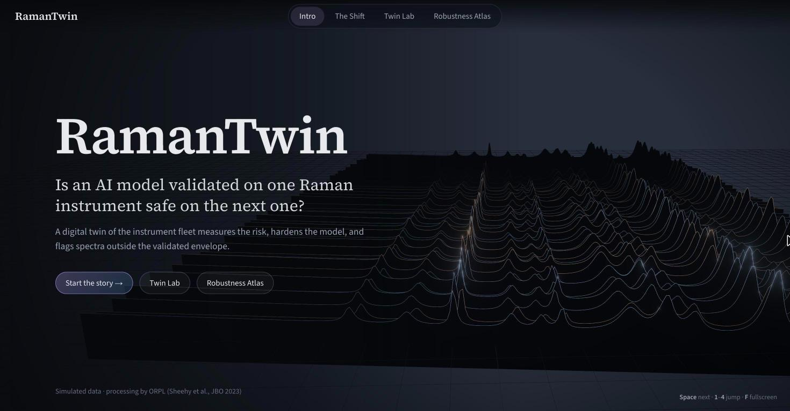
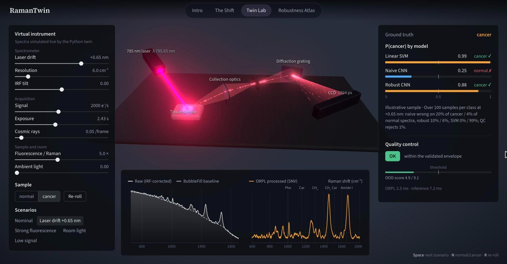

# RamanTwin

**Is a Raman AI model validated on one instrument safe on the next one?**

RamanTwin is a digital twin of 785 nm Raman spectrometers. It simulates a fleet of instruments, processes
every acquisition with the open-source [ORPL](https://github.com/mr-sheg/orpl) pipeline, and uses the
result to **stress-test spectral classifiers across instruments, compare training strategies, and flag
spectra outside the validated envelope**.



> All spectra are simulated and no patient data is used. The twin, the evaluation protocol and the quality
> control are meant to be pointed at real acquisitions; the numbers below describe the simulation only.

## Why
Clinical Raman models are usually trained and validated on a handful of instruments. As a fleet grows
(new sites, new units from production), every instrument becomes a new domain. Calibration with a Tylenol
standard and a NIST SRM 2241 luminescence standard fixes the x-axis and the instrument response; what
calibration cannot see (laser drift after calibration, spectral resolution, fluorescence level,
signal-to-noise) still moves the spectra. RamanTwin makes that residual risk measurable.

| After ORPL: calibration-visible effects are corrected, drift and resolution remain | Domain-randomised CNN embedding of unseen spectra |
|---|---|
|  |  |

## What it does
| Step | Module | Highlights |
|---|---|---|
| Tissue model | `ramantwin.biochem` | 7 components with literature band assignments, cancer vs normal trends, patient and intra-patient variability |
| Instrument twin | `ramantwin.instrument` | dispersion errors, laser drift (16.2 cm⁻¹/nm), line shape, autofluorescence, CCD response and etaloning, shot/dark/read noise, cosmic rays, room light, saturation |
| ORPL processing | `ramantwin.pipeline` | dark → `crfilter_multi` → mean → Tylenol `autogenx` → NIST `compute_irf` → truncation → BubbleFill → SNV |
| Fleet datasets | `ramantwin.fleet` | 2 train instruments + 10 unseen fleet instruments, each with its own patients |
| Models | `ramantwin.ml` | simple linear SVM baseline, naive 1D CNN, "robust" 1D CNN trained on the same patients re-acquired through 12 randomised twins, plus augmentation |
| Quality control | `ramantwin.ml.qc` | Mahalanobis OOD on embeddings (drives abstention) and physics checks in the live API (saturation, argon room-light line, low SNR) |
| Evaluation | `ramantwin.ml.evaluate` | leave-instruments-out, patient-grouped splits, bootstrap CIs, robustness atlas, ablation |
| Live demo | `ramantwin.api` + `web/` | FastAPI + three.js, runs offline |

## Setup of the simulated study
- **Train instruments**: 2 units close to nominal (post-calibration laser drift −0.02 and +0.01 nm,
  fluorescence/Raman ≈ 4.9), 60 patients each, 5 spectra per patient: 76 patients for training, 20 for
  validation (early stopping and temperature, shared by all models), 24 held out.
- **Fleet**: 10 unseen units, 60 patients each. Laser drift σ 0.25 nm (≈ 4 cm⁻¹, up to 0.41 nm), resolution
  and fluorescence drawn around nominal. A post-calibration drift of 0.3–0.4 nm is deliberately pessimistic
  for a stabilised 785 nm laser; it stands in for every residual axis error.
- **Hard fleet**: 6 units from a wider distribution (drift up to 0.58 nm, resolution up to 19.6 cm⁻¹,
  fluorescence up to 29×), 40 patients each.
- **Robust CNN training set**: the same 76 training patients, original spectra plus re-acquisitions through
  12 randomised twins (4 940 training spectra, versus 380 for the naive models).

## Results (simulated)
Balanced accuracy. Fleet and hard-fleet brackets: 95 % CI from a hierarchical bootstrap (instruments, then
patients). Held-out brackets: patient bootstrap over the 24 held-out patients.

| Model | Train instruments, held-out patients | Fleet mean | Fleet worst | Hard fleet mean | Hard fleet worst |
|---|---|---|---|---|---|
| Linear SVM baseline | 0.87 [0.78, 0.94] | 0.57 [0.52, 0.63] | 0.50 | 0.60 [0.52, 0.71] | 0.50 |
| Naive CNN | 0.87 [0.76, 0.96] | 0.80 [0.76, 0.84] | 0.72 | 0.63 [0.54, 0.74] | 0.51 |
| Naive CNN + augmentation (ablation) | 0.86 [0.75, 0.95] | 0.86 [0.83, 0.89] | 0.78 | 0.77 [0.68, 0.86] | 0.59 |
| Robust CNN (domain-randomised) | 0.91 [0.82, 0.98] | 0.89 [0.86, 0.91] | 0.80 | 0.83 [0.79, 0.87] | 0.80 |

Paired differences (same bootstrap draws):

| | Fleet | Hard fleet |
|---|---|---|
| Robust − naive | +0.088 [0.057, 0.124] | +0.204 [0.100, 0.300] |
| Robust − (naive + augmentation) | +0.024 [0.001, 0.051] | +0.062 [−0.005, 0.141] |

What this does and does not show:
- Training-time variation is what matters: **augmentation alone accounts for most of the gain**, on the fleet
  and on the hard fleet. Twin re-acquisition adds a small further gain on the fleet; on the hard fleet the
  extra gain is not significant. The robust model also sees 13× more spectra, so this ablation does not
  separate twin physics from data volume.
- The twin's clearest value here is as an **evaluation instrument**: it exposes the failure modes
  (drift, fluorescence, SNR, room light) and maps where each model holds (atlas below).
- The linear SVM baseline (standardised wavenumbers + linear SVM, trained on two nearly identical
  instruments) is not a reproduction of any published pipeline. Its within-instrument AUC on the fleet
  stays at 0.88 on average (min 0.67), but its decision threshold does not transfer across instruments.
- Abstention uses the OOD score only. The robust model abstains on 5.8 % of fleet spectra and 18.2 % of
  hard-fleet spectra (85 % on the most shifted unit, HF-04). It flags shifted instruments but does not raise
  the accuracy of accepted spectra on the hard fleet (0.83 → 0.81); calibrating selective prediction is
  future work.
- Physics checks (live API), over 4 held-out seeds × 60 spectra per condition: room light (ambient ≥ 0.3)
  detected on ≥ 90 %, 0 false positives on clean spectra from 4 to 20 cm⁻¹ resolution; the low-SNR check
  fires on ≥ 97 % of spectra at 500 e⁻/s, 0.5 s, one accumulation.
- Latency on an Apple M2 laptop: ORPL 0.5 ms and ONNX CNN 0.1 ms per spectrum in batch; a live
  `/api/simulate` request (acquisition, ORPL, three models, QC) takes about 5–8 ms.




## Run it
```bash
uv sync
uv run python -m ramantwin.fleet --preset demo --out data/demo                     # ~10 s
uv run python -m ramantwin.ml.train --data data/demo --out artifacts                # ~1.5 min
uv run python -m ramantwin.ml.export --data data/demo --artifacts artifacts --out web/public/data
(cd web && npm ci && npm run build)
uv run ramantwin-demo --artifacts artifacts                                         # http://127.0.0.1:8000
```
The exported files in `web/public/data/` are committed, so `cd web && npm ci && npm run dev` shows the three
scenes without Python (the Twin Lab then replays recorded scenarios).

Keys: `1`–`4` views, `Space` next step, `C` colour mode, `N`/`R` sample, `F` fullscreen.

## Limitations
- Simulated data only, and sim-to-sim: the fleet comes from the same family of twins as the randomised
  training instruments; the hard fleet is wider but still simulated. Validation on real instruments,
  phantoms and patient data is the necessary next step.
- Training and fleet data use a fixed 1 s exposure; the atlas and Twin Lab scenarios use automatic exposure
  (a spot check on 12 atlas cells found differences within ±0.05, with no systematic direction).
- Small simulated cohorts (24 held-out patients, 60 per fleet unit, 40 per hard-fleet unit): read small
  differences through their confidence intervals.

## ORPL compatibility note
`orpl.calibration.xaxis_from_peaks` calls `float()` on the shape-(1,) residual returned by `np.polyfit`,
which raises `TypeError` on NumPy 2.x and breaks `autogenx`. `ramantwin.orpl_compat` patches it at import.

## Acknowledgements
ORPL: G. Sheehy et al., *Open-sourced Raman spectroscopy data processing package implementing a baseline
removal algorithm validated from multiple datasets acquired in human tissue and biofluids*,
J. Biomed. Opt. 28(2), 025002 (2023).
Interface fonts: Source Sans 3 and Source Serif 4 by Adobe (SIL Open Font License), bundled through fontsource.
