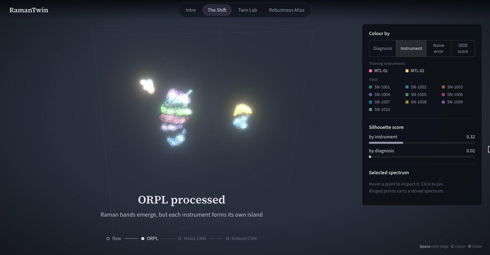
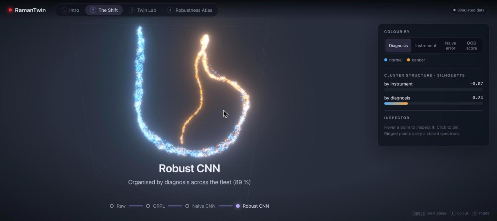
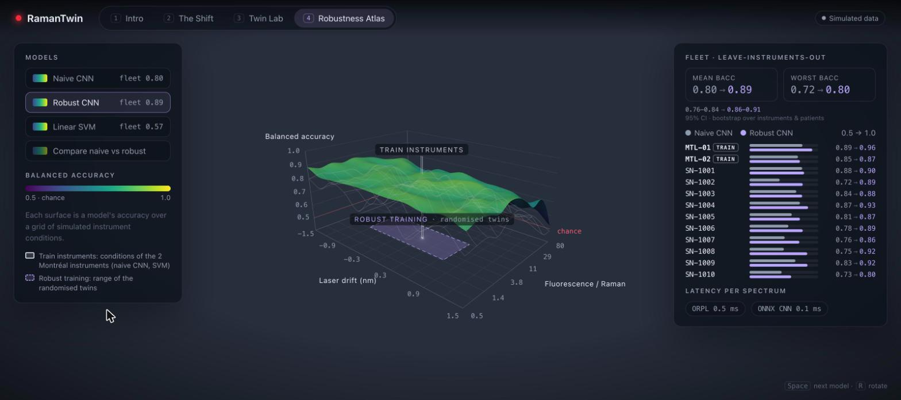

# RamanTwin

**Is a Raman AI model validated on one instrument safe on the next one?**

RamanTwin is a digital twin of 785 nm Raman spectrometers. It simulates a fleet of instruments, processes
every acquisition with the open-source [ORPL](https://github.com/mr-sheg/orpl) pipeline, and uses the
result to **stress-test, harden and monitor** spectral classifiers across instruments and sites.


> All spectra are simulated and no patient data is used. The twin, the evaluation protocol and the quality
> control are designed to be pointed at real acquisitions; the numbers below describe the simulation only.

## Why
Clinical Raman models are usually trained and validated on a handful of instruments. As a fleet grows
(new sites, new units from production), every instrument becomes a new domain. Calibration with a Tylenol
standard and a NIST SRM 2241 luminescence standard fixes the x-axis and the instrument response, but laser
drift after calibration, spectral resolution, fluorescence level and signal-to-noise still move the spectra.
RamanTwin makes that risk measurable, trains models that survive it, and flags spectra outside the validated
envelope.

| ORPL removes the obvious, not the instrument signature | Robust CNN: organised by diagnosis across the fleet |
|---|---|
|  |  |

## What it does
| Step | Module | Highlights |
|---|---|---|
| Tissue model | `ramantwin.biochem` | 7 components with literature band assignments, cancer vs normal trends, patient and intra-patient variability |
| Instrument twin | `ramantwin.instrument` | dispersion errors, laser drift (16.2 cm⁻¹/nm), line shape, autofluorescence, CCD response and etaloning, shot/dark/read noise, cosmic rays, room light, saturation |
| ORPL processing | `ramantwin.pipeline` | dark → `crfilter_multi` → mean → Tylenol `autogenx` → NIST `compute_irf` → truncation → BubbleFill → SNV |
| Fleet datasets | `ramantwin.fleet` | 2 train instruments + 10 unseen fleet instruments, own patients per instrument |
| Models | `ramantwin.ml` | linear SVM, naive 1D CNN, robust 1D CNN trained through 12 randomised twins + augmentation |
| Quality control | `ramantwin.ml.qc` | Mahalanobis OOD on embeddings + physics checks (saturation, argon room-light line, low SNR) → abstention |
| Evaluation | `ramantwin.ml.evaluate` | leave-instruments-out, patient-grouped splits, hierarchical bootstrap CIs, robustness atlas, ablation |
| Live demo | `ramantwin.api` + `web/` | FastAPI + three.js, runs offline |

## Results (simulated fleet)
Balanced accuracy. Fleet = 10 unseen instruments (spread 1.0); hard fleet = 6 instruments drawn from a wider
distribution (spread 2.0 vs 1.5 for the randomised twins), with their own patients. Brackets: 95 % CI from a
hierarchical bootstrap (instruments, then patients).

| Model | Train instruments, held-out patients | Fleet mean | Fleet worst | Hard fleet mean | Hard fleet worst |
|---|---|---|---|---|---|
| Linear SVM | 0.87 [0.78, 0.94] | 0.57 [0.52, 0.63] | 0.50 | 0.60 [0.52, 0.71] | 0.50 |
| Naive CNN | 0.87 [0.76, 0.96] | 0.80 [0.76, 0.84] | 0.72 | 0.63 [0.54, 0.74] | 0.51 |
| Naive CNN + augmentation (ablation) | 0.86 [0.75, 0.95] | 0.86 [0.83, 0.89] | 0.78 | 0.77 [0.68, 0.86] | 0.59 |
| **Robust CNN (randomised twins)** | **0.91 [0.82, 0.98]** | **0.89 [0.86, 0.91]** | **0.80** | **0.83 [0.79, 0.87]** | **0.80** |

Paired differences (same bootstrap draws):

| | Fleet | Hard fleet |
|---|---|---|
| Robust − naive | +0.088 [0.057, 0.124] | +0.204 [0.100, 0.300] |
| Robust − naive + augmentation | +0.024 [0.001, 0.051] | +0.062 [−0.005, 0.141] |

- The linear SVM still ranks spectra well on the fleet (AUC 0.88) but its decision threshold does not
  transfer: a per-instrument threshold recalibration is the cheap fix to test.
- Augmentation alone recovers most of the gap on the fleet; randomised twins add the most on the hard fleet.
- QC: the robust model abstains on 5.8 % of fleet spectra and 18.2 % of hard-fleet spectra. On held-out seeds
  the room-light check detects ≥ 93 % of contaminated spectra with 0 false positives from 4 to 20 cm⁻¹
  resolution; the low-SNR check fires on 98–100 % of low-signal spectra.
- Latency per spectrum on a laptop CPU: ORPL 0.5 ms, ONNX CNN 0.1 ms; `/api/simulate` end to end ≈ 6 ms.



## Run it
```bash
uv sync
uv run python -m ramantwin.fleet --preset demo --out data/demo                     # ~10 s
uv run python -m ramantwin.ml.train --data data/demo --out artifacts                # ~1.5 min
uv run python -m ramantwin.ml.export --data data/demo --artifacts artifacts --out web/public/data
(cd web && npm ci && npm run build)
uv run ramantwin-demo --artifacts artifacts                                         # http://127.0.0.1:8000
```
The exported files in `web/public/data/` are committed, so `cd web && npm ci && npm run dev` shows the three
scenes without Python (the Twin Lab then replays recorded scenarios).

Keys: `1`–`4` views, `Space` next step, `C` colour mode, `N`/`R` sample, `F` fullscreen.

## Limitations
- Simulated data only. The fleet comes from the same family of twins as the randomised training instruments
  (sim-to-sim); the hard fleet is wider but still simulated. Validation on real instruments, phantoms and
  patient data is the necessary next step.
- Training and fleet data use a fixed 1 s exposure; the atlas and Twin Lab scenarios use automatic exposure
  (measured effect within ±0.05, no systematic direction).
- 60 simulated patients per instrument; see the confidence intervals before reading small differences.

## ORPL compatibility note
`orpl.calibration.xaxis_from_peaks` calls `float()` on the shape-(1,) residual returned by `np.polyfit`,
which raises `TypeError` on NumPy 2.x and breaks `autogenx`. `ramantwin.orpl_compat` patches it at import.

## Acknowledgements
ORPL: G. Sheehy et al., *Open-sourced Raman spectroscopy data processing package implementing a baseline
removal algorithm validated from multiple datasets acquired in human tissue and biofluids*,
J. Biomed. Opt. 28(2), 025002 (2023).
